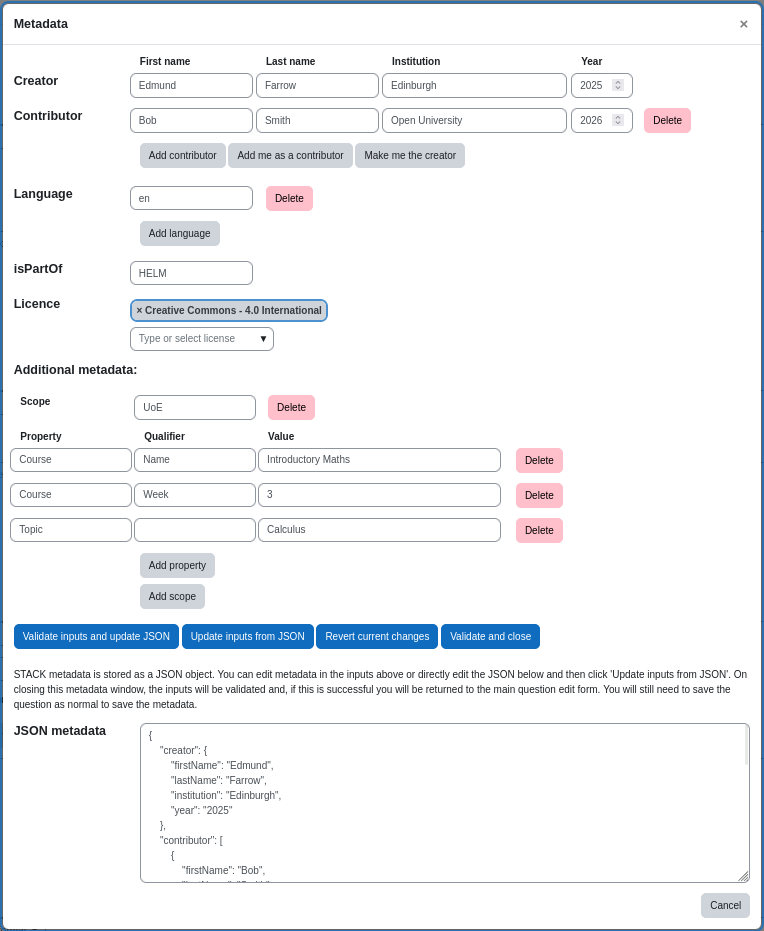

# Question metadata

STACK questions support flexible metadata. Metadata is recorded in JSON format in two database fields - `metadata` and `prescribedmetadata`. The `metadata` field holds user-editable metadata. `prescribedmetadata` holds metadata that STACK maintains automatically and that cannot be edited in the question form: a universal question id and the ids of the question's earlier versions (see [Question id and history](#question-id-and-history) below).

New questions will be created with editable `metadata` similar to the following:
```
{
    "author":[
        {
            "firstName": "Current", // Default: $USER->firstname
            "lastName": "User", // Default: $USER->lastname
            "institution": "", // Default: $USER->institution
            "year": "2026" // Default: Current year
        }
    ],
    "language": [
        "en" // Default: Current language
    ],
    "license": "unknown", // Default: $CFG->sitedefaultlicense
    "isPartOf": "", // Very basic field for linking/identifying content e.g. HELM, STACK Library, UoE Algebra1
    "additional": {}, // Custom fields scoped by institution or project and in a defined JSON format (see below)
    "freeform" {} // Completely user-defined metadata
}
```
A question can have multiple authors. The metadata scheme is loosely based on [the Dublin Core specification](https://www.dublincore.org/specifications/dublin-core/dcmi-terms/). Authors are given a first and last name for consistency with name storage within Moodle. If this is unsuitable, enter the author's full name in the last name field. You can enter the same author twice with a different year if you wish to preserve a limited edit history timeline.

Additional metadata is stored in Scope->Property->Qualifier->Value or Scope->Property->Value format. Scope identifies the metadata scheme being used. For instance, two institutions might have the property `Level` that has different meanings. Scope allows differentiation between the two:
```
"additional": {
    "Edinburgh": {
        "Level": "Undergraduate"
    },
    "Glasgow": {
        "Level": "Year 2"
    }
}
```
A property within a scope can have qualifiers:
```
"additional": {
    "Edinburgh": {
        "Course": {
            "Name": "Introductory Maths",
            "Week": "3"
        }
    }
}
```
or simply a value:
```
"additional": {
    "Edinburgh": {
        "Course": "Introductory Maths"
    }
}
```
If any entry for a property has a qualifier, then all entries must do so in order for valid JSON to be created:
```
"additional": {
    "Scope1": {
        "Property1": {
            "Qualifier1": "Value1",
            "Qualifier2": "Value2",
            "Qualifier3": [
                "Value3",
                "Value4"
            ]
        },
        "Property2": [
            "Value5",
            "Value6",
            "Value7"
        ],
        "Property3": "Value8"
    },
    "Scope2": {
        "Property1": "Value2",
        "Property4": "Value4"
    }
}
```
The freeform metadata input allows entry of further metadata in whatever format the user requires. It simply has to be valid JSON. This can also be added in the main JSON metadata input field but (unlike `additional` entries) does not create additional input fields and buttons. This field is for power users who require greater nesting depth in their metadata.

All information in the question `metadata` field can be updated via the button 'View and edit full metadata' in the question edit form. This launches a pop-up where the metadata information can be updated via input boxes or the JSON can be manually amended and validated.



Switch the modal to edit, update the input boxes and click 'Validate inputs and update JSON' to display the JSON output. Update the JSON and click 'Update inputs from JSON' to fill in the input boxes from the JSON. 'Validate and close' will take the contents of the input boxes, validate them and then create and store JSON ready to be saved as part of the STACK question. The question edit form must still be saved normally once the pop-up has closed in order to save this JSON to the question.

Please note that although you can update either the JSON or the input boxes, the form saves the contents of the input boxes. If you update the JSON you must click 'Update inputs from JSON' without a JSON error being displayed before clicking 'Validate and close'.

Example metadata:
```
{
    "author": [
        {
            "firstName": "Dave",
            "lastName": "Summers",
            "institution": "Edinburgh",
            "year": "2025"
        },
        {
            "firstName": "Bob",
            "lastName": "Smith",
            "institution": "Open University",
            "year": "2026"
        },
        {
            "firstName": "Tim",
            "lastName": "Jones",
            "institution": "",
            "year": "2026"
        }
    ],
    "language": [
        "en",
        "de"
    ],
    "isPartOf": "HELM",
    "license": "cc-4.0",
    "additional": {
        "Edinburgh": {
            "Course": {
                "Name": "Introductory Maths",
                "Week": "3",
                "Code": [
                    "AA",
                    "BB"
                ]
            },
            "Topic": [
                "Calculus",
                "Geometry",
                "Statistics"
            ],
            "Level": "Undergraduate"
        },
        "HELM": {
            "Workbook": "10",
            "Level": "Basic"
        }
    },
    "freeform": {}
}
```

## Question id and history

Every STACK question carries a universal id in `prescribedmetadata`. The id stays with the question when it is exported, shared and imported on another site, so that question databases such as ATLAS (atlas.nrw) can recognise a question they already hold and can tell that one question is a later version of another.

A new id is created each time a question is saved in the STACK question editing form or in the XML editor. This includes the first save of a new question. The previous id, if there was one, is appended to `atlasIdHistory`.

```
{
    "atlasId": "ATLAS-019a5c3f7e21-b4705fd52b77-9ebf4fb5-4c5f",
    "atlasIdHistory": [
        "ATLAS-0199d2a41c08-01a1da01c37f-3c5e9a12-3b96"
    ]
}
```

| Key | Written by | Meaning |
| --- | --- | --- |
| `atlasId` | STACK | The id of this version of the question. |
| `atlasIdHistory` | STACK | The ids of the versions this question was derived from, oldest first. Empty for a question that was never edited. |

### Format of the id

```
ATLAS-{time}-{hash}-{random}-{checksum}
```

| Part | Length | Content |
| --- | --- | --- |
| `time` | 12 hex digits | Time of creation in milliseconds since 1970-01-01 UTC. |
| `hash` | 12 hex digits | The first 6 bytes of the SHA-1 hash of the question's Moodle XML export (see below). |
| `random` | 8 hex digits | 4 random bytes. |
| `checksum` | 4 hex digits | The first 4 hex digits of the SHA-256 hash of everything before it, i.e. of `ATLAS-{time}-{hash}-{random}`. |

The hash is taken over the Moodle XML export of the single question, without category and context information, after removing

* the `<prescribedmetadata>` element, and
* the comment `<!-- question: 1234 -->` that Moodle writes before each question.

The `<metadata>` element is part of the hashed text. Because of the time and the random part, saving the same question twice gives two different ids; the hash part only records which content the id was created for.

### In Moodle XML

Both metadata fields are exported and imported normally as part of Moodle XML, allowing automated addition of metadata to large question banks with the aid of Gitsync.
```
<prescribedmetadata>{"atlasIdHistory":["ATLAS-0199d2a41c08-01a1da01c37f-3c5e9a12-3b96"],"atlasId":"ATLAS-019a5c3f7e21-b4705fd52b77-9ebf4fb5-4c5f"}</prescribedmetadata>
<metadata>{"author":[{"firstName":"Dave","lastName":"Summers","institution":"Edinburgh","year":"2025"},{"firstName":"Bob","lastName":"Smith","institution":"Open University","year":"2026"}],"language":["en"],"isPartOf":"HELM","license":"cc-4.0","additional":{"UoE":{"Course":{"Name":"Introductory Maths","Week":"3"},"Topic":"Calculus"}},"freeform":{}}</metadata>
```

If you edit question XML outside Moodle (for example with Gitsync or a text editor), leave `<prescribedmetadata>` as it is. No new id is created for such an edit. A database that receives the file sees a known id with changed content and treats the question as a new version of that id.

