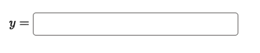

# Answer input (short-answer questions)

In STACK you often need to enter an answer which is a number or an algebraic expression.
For short-answer questions, which provide one or more boxes for you to enter your answer(s) (such as that shown below) you should type in your answers using the same syntax as that used in the Maxima symbolic mathematics system. This syntax is broadly similar to the syntax used for mathematical formulae in graphical calculators; general programming languages such as Java, C and Basic; and in spreadsheet programs. You will find it useful to master it.

(If you are entering a free-form text answer, in which a complete solution is entered within a box on the left, and your answer is displayed formatted on the right, the you should follow the advice in [Free-text Markdown](Free_text_markdown.md) and [Free-text AsciiMath](Free_text_AsciiMath_intro.md) rather than this. )

For example, to enter \( e^{-t}\sin(3t)\) you need to type in

    e^(-t)*sin(3*t)

The system tries quite hard to give helpful information about any syntax errors.
It might also forgive some errors you make.

## Basic Notation

### Numbers

You should type in numbers without spaces, and use fractions rather than decimals where possible. For example, \(1/4\) should be entered as `1/4`, not as `0.25`. In some situations, entering a decimal or floating-point number is forbidden - doing so will result in a warning being displayed and you should re-enter your answer in an appropriate alternative form. Some other hints are given below.

* You can also use scientific notation for large numbers, e.g. \(1000\) can be entered as either `1E+3`, or as `1e3`.

* \(\pi\) is entered as either `pi` or `%pi`.

* \(i\) is entered as either `i` or `%i`.

  * \(i\) is also sometimes entered as `j` , especially in engineering contexts. If in doubt ask your teacher.
  * You could also use `sqrt(-1)`, or `(-1)^(1/2)`, but take care with the brackets.

* \(e\), the base of the natural logarithms, is entered as either `e` or `%e`.   Note that scientific notation can be written using `e` or `E`, e.g. `6.02e23`.  Preference is given to scientific notation, rather than interpreting `e` as the base of the natural logarithms.  Use explicit multiplication signs to remove this ambiguity, e.g. if you want the base of the natural logarithm, then type `6.02*e*23` instead.

### Multiplication

Use a star for multiplication. Forgetting this is by far the most common source of syntax errors. For example,

* \(3x\) should be entered as `3*x`.
* \(x(ax+1)(x-1)\) should be entered as `x*(a*x+1)*(x-1)`.

STACK does sometimes try to insert stars for you where there is no ambiguity, e.g. `2x` or `(x+1)(x-1)`. However, this guessing cannot be perfect since traditional mathematical notation is sometimes ambiguous! For example, consider \(f(x+1)\) and \(x(t+1)\).

### Powers

Use a caret (^) for raising something to a power: for example, \(x^2\) should be entered as `x^2`.
You can get a caret by holding down the SHIFT key and pressing the 6 key on most keyboards.
Negative or fractional powers need brackets:

* \(x^{-2}\) should be entered as `x^(-2)`.
* \(x^{1/3}\) should be entered as `x^(1/3)`.
* The function `root(x,n)` can be used for `x^(1/n)`.  If you omit the second argument you get `root(x)=sqrt(x)`.

### Brackets

Brackets are important to group terms in an expression. This is particularly important since the answer input uses a one-dimensional syntax rather than traditional written mathematics. Try to consciously develop a sense of when you need brackets and avoid putting in too many.

For example,

\[\frac{a+b}{c+d}\]

should be entered as `(a+b)/(c+d)`.

If you type `a+b/(c+d)`, then the system will think that you mean

\[a+\frac{b}{c+d}.\]

If you type `(a+b)/c+d`, then the system will think that you mean

\[\frac{a+b}{c}+d.\]

If you type `a+b/c+d`, then the system will think that you mean

\[a+\frac{b}{c}+d.\]

Think carefully about the expression `a/b/c`.  What do you think this means?  There are two options

\[\frac{a}{b}\cdot\frac{1}{c} = \frac{a}{bc}\quad\text{or}\quad\frac{a}{\frac{b}{c}}=\frac{ac}{b}.\]

The system actually interprets this as \(\frac{a}{bc}\).  If in doubt use brackets.

Note that in this context you should always use ordinary round brackets (like (a+b)), not square or curly ones (like [a+b] or {a+b}), because

* `{a+b}` means a set,
* `[a+b]` means a list.

### Scientific units

You may be asked to answer a question in which the answer has units, for example \( 9.81\text{m}\text{s}^{-2} \).  To enter units you must use multiplication, so this is entered as either `9.81*m/s^2` or `9.81*m*s^(-2)`.  Don't use a space, or another symbol such as `+`.

### Subscripts

Use the underscore character to denote a subscript.  For example, \(a_b\) should be entered as `a_b`.

### Additional examples

* \(2^{a+b}\) should be entered as `2^(a+b)`
* \(2 \cos 3x\) should be entered as `2*cos(3*x)`
* \(e^{ax}\sin(bx)\) should be entered as `exp(a*x)*sin(b*x)`
* \( (ax^2 + b x + c)^{-1}\) should be entered as `(a*x^2 + b*x + c)^(-1)`.

## Functions

* **Standard functions**: Functions, such as \(\sin\), \(\cos\), \(\tan\), \(\exp\), \(\log\) and so on
  can be entered using their usual names. However, the argument must always be enclosed in brackets:
  \(\sin x\) should be entered as `sin(x)`, \(\ln 3\) should be entered as `ln(3)` and so on.
* **Modulus function**: The modulus function, sometimes called the absolute value of _x_,
  is written as |_x_| in traditional notation. This must be entered as `abs(x)`.

### Trigonometrical functions

Things to remember:

* The system uses radians for the angles, not degrees!
* The function \(1/\sin(x)\) should be typed in as `csc(x)` rather than `cosec(x)`.  
  You can type `cosec(x)` or just call it `1/sin(x)` if you prefer.
* \(\sin^2x\) must be entered as `sin(x)^2` (which is what it really means, after all).
  Similarly for \(\tan^2(x)\), \(\sinh^2(x)\) and so on.
* Recall that \(\sin^{-1}(x)\) traditionally means the number \(t\) such that \(\sin(t) = x\),
  which is completely different from the number \(\sin(x)^{-1} = 1/\sin(x)\).
  This traditional notation is really rather unfortunate and is not used within the system.
  \(\sin^{-1}(x)\) should be entered as `asin(x)`. Similarly, \(\tan^{-1}(x)\) should be entered as `atan(x)` and so on.

### Exponentials and Logarithms

* To enter the exponential function type `exp(x)`. Typing `e^x` should also work , but gets you into bad habits if you later use a computer-algebra system!
* Type `ln(x)` or `log(x)` to enter the _natural logarithm_ of \(x\) with base \(e\approx 2.71\cdots\). Note that both of these start with a lower case l for logarithm, not a capital I (`i`).
* The logarithm of \(x\) to base \(10\) is entered as `lg(x)`.
* The logarithm of \(x\) to base \(a\) is entered as `lg(x,a)`, sometimes written \(\log_{a}(x)\).

## Matrices

In questions requiring matrix answers, you may be given a grid of boxes to fill in with each individual element. If not, the question may provide a hint as to the correct syntax to use. Otherwise you will need to use Maxima's notation for entering the matrix.

The matrix:

\[ \left( \begin{array}{ccc} 1 & 2 & 3 \\ 4 & 5 & 6 \end{array} \right)\]

must be entered as `matrix([1,2,3],[4,5,6])`.

Each row is entered as a *list*, and each row should be the same length.
The function matrix is used to indicate this is a matrix and not a "list of lists".

## Equations and inequalities

Equations can be entered using the equals sign. For example, to enter the equation \(y=x^2-2x+1\) type `y=x^2-2*x+1`.

Inequalities can be entered using the greater than and less than signs, and possibly the equals sign on your keyboard, as follows.

| Inequality    | Syntax |
| ------------- | ------ |
| \(>\)         | `>`    |
| \(<\)         | `<`    |
| \(\leqslant\) | `<=`   |
| \(\geqslant\) | `>=`   |

Note there is no space between these symbols in the less/greater than or equal to cases.

You can enter "not equals to" using the `#` symbol.  For example, `x#1` is interpreted as \(x\neq 1\).

Sometimes you will need to connect inequalities together as `x>1 and x<=5`.  You must use the logical connectives `and` and `or`.  "Chained inequalities" such as \(1<x<5\) are not permitted as input syntax.  You should enter this as `1<x and x<5`.

## Other notes

* **Greek letters** can be entered using their English names. For example, enter \(\alpha+\beta\) as `alpha+beta`, and \(2\pi\) as `2*pi`.
* **Sets**: To enter a set such as \(\{1,2,3\}\)  you could use the function `set(1,2,3)`, or use curly brackets and simply type `{1,2,3}`.
* **Lists**: can be entered using square brackets. For example, to enter the list _1,2,2,3_ type `[1,2,2,3]`.

You can also learn about the right syntax by doing tests in practice mode and asking for the solutions; as well as displaying the right answers in ordinary mathematical notation, the system will tell you how they could be entered. However, there are often several possible ways, and the system will not always suggest the easiest one.

If you have difficulties in entering your answer you should contact your teacher.
