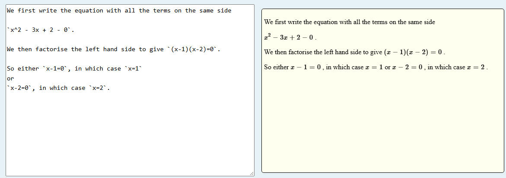

# Free-text mathematical input: summary

In questions that allow you to enter multiple lines of text and mathematics containing an extended solution to some problem, mathematics is entered using *AsciiMath* syntax between *backticks*, for example `` ` x^2 + 2x ` `` .  This section provides and extensive list of this syntax. The complete reference is available from [asciimath.org](https://asciimath.org/). 

**Note** This only applies to questions where  two panels are shown (as below), with one (on the left) for entering your solution and one (on the right) where your answer is displayed properly formatted.

**Operation symbols**

| Type   | See            | TeX alt             |
| ------ | -------------- | ------------------- |
| `+`    | \(+\)          |                     |
| `-`    | \(-\)          |                     |
| `*`    | \(\cdot\)      | cdot                |
| `**`   | \(\ast\)       | ast                 |
| `***`  | \(\star\)      | star                |
| `//`   | \(//\)         |                     |
| `\\`   | \(\backslash\) | backslash, setminus |
| `xx`   | \(\times\)     | times               |
| `-:`   | \(\div\)       | div                 |
| `      | ><`            | \(\ltimes\)         |
| `><    | `              | \(\rtimes\)         |
| `      | ><             | `                   |
| `@`    | \(\circ\)      | circ                |
| `o+`   | \(\oplus\)     | oplus               |
| `ox`   | \(\otimes\)    | otimes              |
| `o.`   | \(\odot\)      | odot                |
| `sum`  | \(\sum\)       |                     |
| `prod` | \(\prod\)      |                     |
| `^^`   | \(\wedge\)     | wedge               |
| `^^^`  | \(\bigwedge\)  | bigwedge            |
| `vv`   | \(\vee\)       | vee                 |
| `vvv`  | \(\bigvee\)    | bigvee              |
| `nn`   | \(\cap\)       | cap                 |
| `nnn`  | \(\bigcap\)    | bigcap              |
| `uu`   | \(\cup\)       | cup                 |
| `uuu`  | \(\bigcup\)    | bigcup              |

 

**Miscellaneous symbols**

| Type         | See             | TeX alt     |
| ------------ | --------------- | ----------- |
| `2/3`        | \(\frac{2}{3}\) | frac{2}{3}  |
| `2^3`        | \(2^3\)         |             |
| `sqrt x`     | \(\sqrt{x}\)    |             |
| `root(3)(x)` | \(\sqrt[3]{x}\) |             |
| `int`        | \(\int\)        |             |
| `oint`       | \(\oint\)       |             |
| `del`        | \(\partial\)    | partial     |
| `grad`       | \(\nabla\)      | nabla       |
| `+-`         | \(\pm\)         | pm          |
| `O/`         | \(\emptyset\)   | emptyset    |
| `oo`         | \(\infty\)      | infty       |
| `aleph`      | \(\aleph\)      |             |
| `:.`         | \(\therefore\)  | therefore   |
| `:'`         | \(\because\)    | because     |
| `            | ...             | `           |
| `            | cdots           | `           |
| `vdots`      | \(\vdots\)      |             |
| `ddots`      | \(\ddots\)      |             |
| `            | \               | `           |
| `            | quad            | `           |
| `/_`         | \(\angle\)      | angle       |
| `frown`      | \(\frown\)      |             |
| `/_\`        | \(\triangle\)   | triangle    |
| `diamond`    | \(\diamond\)    |             |
| `square`     | \(\square\)     |             |
| `            | __`             | \(\lfloor\) |
| `__          | `               | \(\rfloor\) |
| `            | ~`              | \(\lceil\)  |
| `~           | `               | \(\rceil\)  |
| `CC`         | \(\mathbb{C}\)  |             |
| `NN`         | \(\mathbb{N}\)  |             |
| `QQ`         | \(\mathbb{Q}\)  |             |
| `RR`         | \(\mathbb{R}\)  |             |
| `ZZ`         | \(\mathbb{Z}\)  |             |
| `"hi"`       | \(\text{hi}\)   | `\text{hi}` |

 

**Relation symbols**

| Type   | See           | TeX alt  |
| ------ | ------------- | -------- |
| `=`    | \(=\)         |          |
| `!=`   | \(\ne\)       | ne       |
| `<`    | \(<\)         | lt       |
| `>`    | \(>\)         | gt       |
| `<=`   | \(\le\)       | le       |
| `>=`   | \(\ge\)       | ge       |
| `mlt`  | \(\ll\)       | ll       |
| `mgt`  | \(\gg\)       | gg       |
| `-<`   | \(\prec\)     | prec     |
| `-<=`  | \(\preceq\)   | preceq   |
| `>-`   | \(\succ\)     | succ     |
| `> -=` | \(\succeq\)   | succeq   |
| `in`   | \(\in\)       |          |
| `!in`  | \(\notin\)    | notin    |
| `sub`  | \(\subset\)   | subset   |
| `sup`  | \(\supset\)   | supset   |
| `sube` | \(\subseteq\) | subseteq |
| `supe` | \(\supseteq\) | supseteq |
| `-=`   | \(\equiv\)    | equiv    |
| `~=`   | \(\cong\)     | cong     |
| `~~`   | \(\approx\)   | approx   |
| `prop` | \(\propto\)   | propto   |

 

**Logical symbols**

| Type  | See           | TeX alt     |
| ----- | ------------- | ----------- |
| `and` | \(\land\)     |             |
| `or`  | \(\lor\)      |             |
| `not` | \(\neg\)      | neg         |
| `=>`  | \(\implies\)  | implies     |
| `if`  | \(\text{if}\) |             |
| `<=>` | \(\iff\)      | iff         |
| `AA`  | \(\forall\)   | forall      |
| `EE`  | \(\exists\)   | exists      |
| `_    | _`            | \(\bot\)    |
| `TT`  | \(\top\)      | top         |
| `     | --`           | \(\vdash\)  |
| `     | ==`           | \(\models\) |

 

**Grouping brackets**

| Type         | See                   | TeX alt        |
| ------------ | --------------------- | -------------- |
| `(`          | \((\)                 |                |
| `)`          | \()\)                 |                |
| `[`          | \([\)                 |                |
| `]`          | \(]\)                 |                |
| `(:`         | \(\langle\)           | langle         |
| `:)`         | \(\rangle\)           | rangle         |
| `<<`         | \(\langle\langle\)    |                |
| `>>`         | \(\rangle\rangle\)    |                |
| `floor(x)`   | \(\lfloor x \rfloor\) |                |
| `ceil(x)`    | \(\lceil x \rceil\)   |                |
| `norm(vecx)` | \(\left               | \vec{x} \right |

Note, you can also use `{...}` for curly braces and `abs(x)` for \(|x|\).

**Arrows**

| Type   | See                    | TeX alt           |
| ------ | ---------------------- | ----------------- |
| `uarr` | \(\uparrow\)           | uparrow           |
| `darr` | \(\downarrow\)         | downarrow         |
| `rarr` | \(\rightarrow\)        | rightarrow        |
| `->`   | \(\to\)                | to                |
| `>->`  | \(\rightarrowtail\)    | rightarrowtail    |
| `->>`  | \(\twoheadrightarrow\) | twoheadrightarrow |
| `\|->` | \(\mapsto\)            | mapsto            |
| `larr` | \(\leftarrow\)         | leftarrow         |
| `harr` | \(\leftrightarrow\)    | leftrightarrow    |
| `rArr` | \(\Rightarrow\)        | Rightarrow        |
| `lArr` | \(\Leftarrow\)         | Leftarrow         |
| `hArr` | \(\Leftrightarrow\)    | Leftrightarrow    |

 

**Accents**

| Type             | TeX alt         |
| ---------------- | --------------- |
| `hat x`          |                 |
| `bar x`          | overline x      |
| `ul x`           | underline x     |
| `vec x`          |                 |
| `tilde x`        |                 |
| `dot x`          |                 |
| `ddot x`         |                 |
| `overset(x)(=)`  | overset(x)(=)   |
| `underset(x)(=)` |                 |
| `ubrace(1+2)`    | underbrace(1+2) |
| `obrace(1+2)`    | overbrace(1+2)  |
| `overarc(AB)`    | overparen(AB)   |
| `color(red)(x)`  |                 |
| `cancel(x)`      |                 |

 

**Greek Letters**

| Type         | See             | Type     | See         |
| ------------ | --------------- | -------- | ----------- |
| `alpha`      | \(\alpha\)      |          |             |
| `beta`       | \(\beta\)       |          |             |
| `gamma`      | \(\gamma\)      | `Gamma`  | \(\Gamma\)  |
| `delta`      | \(\delta\)      | `Delta`  | \(\Delta\)  |
| `epsilon`    | \(\epsilon\)    |          |             |
| `varepsilon` | \(\varepsilon\) |          |             |
| `zeta`       | \(\zeta\)       |          |             |
| `eta`        | \(\eta\)        |          |             |
| `theta`      | \(\theta\)      | `Theta`  | \(\Theta\)  |
| `vartheta`   | \(\vartheta\)   |          |             |
| `iota`       | \(\iota\)       |          |             |
| `kappa`      | \(\kappa\)      |          |             |
| `lambda`     | \(\lambda\)     | `Lambda` | \(\Lambda\) |
| `mu`         | \(\mu\)         |          |             |
| `nu`         | \(\nu\)         |          |             |
| `xi`         | \(\xi\)         | `Xi`     | \(\Xi\)     |
| `pi`         | \(\pi\)         | `Pi`     | \(\Pi\)     |
| `rho`        | \(\rho\)        |          |             |
| `sigma`      | \(\sigma\)      | `Sigma`  | \(\Sigma\)  |
| `tau`        | \(\tau\)        |          |             |
| `upsilon`    | \(\upsilon\)    |          |             |
| `phi`        | \(\phi\)        | `Phi`    | \(\Phi\)    |
| `varphi`     | \(\varphi\)     |          |             |
| `chi`        | \(\chi\)        |          |             |
| `psi`        | \(\psi\)        | `Psi`    | \(\Psi\)    |
| `omega`      | \(\omega\)      | `Omega`  | \(\Omega\)  |

 

**Font commands**

| Type           | See                   | TeX alt           |
| -------------- | --------------------- | ----------------- |
| `bb "AaBbCc"`  | \(\mathbf{AaBbCc}\)   | mathbf "AaBbCc"   |
| `bbb "AaBbCc"` | \(\mathbb{AaBbCc}\)   | mathbb "AaBbCc"   |
| `cc "AaBbCc"`  | \(\mathcal{AaBbCc}\)  | mathcal "AaBbCc"  |
| `tt "AaBbCc"`  | \(\mathtt{AaBbCc}\)   | mathtt "AaBbCc"   |
| `fr "AaBbCc"`  | \(\mathfrak{AaBbCc}\) | mathfrak "AaBbCc" |
| `sf "AaBbCc"`  | \(\mathsf{AaBbCc}\)   | mathsf "AaBbCc"   |

 

**Standard Functions:** sin, cos, tan, sec, csc, cot, arcsin, arccos, arctan, sinh, cosh, tanh, sech, csch, coth, exp, log, ln, det, dim, mod, gcd, lcm, lub, glb, min, max, f, g.

### Special Cases

* Matrices: `[[a,b],[c,d]]` yields \(\begin{bmatrix} a & b \\ c & d \end{bmatrix}\)

* Column vectors: `((a),(b))` yields \(\begin{pmatrix} a \\ b \end{pmatrix}\)

* Augmented matrices: `[[a,b,|,c],[d,e,|,f]]` yields \(\left[\begin{array}{cc|c} a & b & c \\ d & e & f \end{array}\right]\)

* Matrices can be used for layout: `{(2x,+,17y,=,23),(x,-,y,=,5):}` yields

\[ \left\{\begin{array}{ccccc} 2x & + & 17y & = & 23 \\ x & - & y & = & 5 \end{array}\right.\]

* Complex subscripts: `lim_(N->oo) sum_(i=0)^N` yields \(\lim_{N \to \infty} \sum_{i=0}^{N}\)

* Subscripts must come before superscripts: `int_0^1 f(x)dx` yields \(\int_{0}^{1} f(x)\,dx\)

* Derivatives: `f'(x) = dy/dx` yields \(f'(x) = \frac{dy}{dx}\)

  For variables other than x, y, z, or t you will need grouping symbols: `(dq)/(dp)` yields \(\frac{dq}{dp}\)

* Overbraces and underbraces:  `ubrace(1+2+3+4)_("4 terms")` yields \(\underbrace{1+2+3+4}_{\text{4 terms}}\)

  `obrace(1+2+3+4)^("4 terms")` yields \(\overbrace{1+2+3+4}^{\text{4 terms}}\)

* Attention: Always try to surround the `>` and `<` characters with spaces so that the HTML parser does not confuse them with opening or closing tags.
