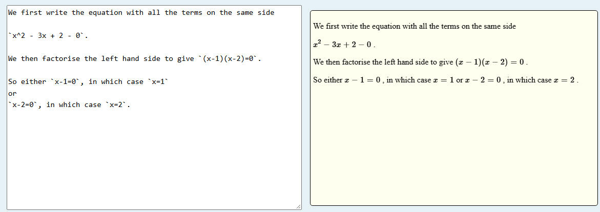

# Free-text text formatting

In questions that allow you to enter multiple lines of text and mathematics containing an extended solution to some problem, text can be formatted using *Markdown* commands.

**Note** This only applies to questions where  two panels are shown (as below), with one (on the left) for entering your solution and one (on the right) where your answer is displayed properly formatted.



Some examples of Markdown formatting are given below. 

```
# Heading

## Sub-heading

Paragraphs are separated by a blank line.

Two spaces at the end of a line  
produce a line break.

Text attributes _italic_, **bold**.

Horizontal rule:

---

Bullet lists nested within numbered list:

  1. fruits
     * apple
     * banana
  2. vegetables
     - carrot
     - broccoli
```

**Warning** If you are familiar with Markdown, you may be used to using backticks to produce a  monospace font:

```
   `monospace`
```

However, free-text input uses backticks for AsciiMath mathematical formatting, as summaried in the [Free-text AsciiMath](Free-text-AsciiMath-intro.md) section.