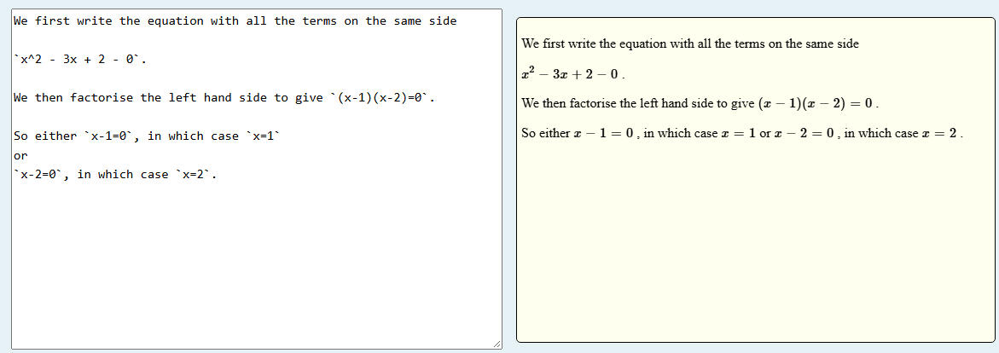

# Free-text: mathematical input (introduction)

In questions that allow you to enter multiple lines of text and mathematics containing an extended solution to some problem, mathematics is entered using *AsciiMath* syntax between *backticks*, for example `` ` x^2 + 2x ` `` .  This section provides an introduction to this syntax. A more complete summary of AsciiMath syntax is in the [Free-text mathematical input (detailed)](Free_text_AsciiMath_summary.md) section online, and the complete reference is available from [asciimath.org](https://asciimath.org/). 

**Note** This only applies to questions where  two panels are shown (as below), with one (on the left) for entering your solution and one (on the right) where your answer is displayed properly formatted.

AsciiMath is an easy-to-write markup language for mathematics.  Most AsciiMath symbols attempt to mimic in text what they look like when displayed, for example the text `oo` represents  \(\infty\), so the input

    `sum_(k=1)^oo 1/k^2=pi^2/6`

is displayed as

 \[\sum_{k=1}^\infty \frac{1}{k^2} = \frac{\pi^2}{6}
\]

If there is text on the same line as the mathematics, or on the lines immediately above or below it, then the mathematics will be displayed *inline*, for example

    This problem asks us to solve `x^2-10x+9=0`, which is a quadratic equation.

otherwise it will be shown as displayed mathematics. Multiple lines of mathematics within backticks are also displayed, and the system will attempt to format them appropriately. For example, the input

    To solve `x^2-10x+9` we work line by line
    `
    x^2-10x+9
    (x-5)^2-16=0
    (x-5)^2-4^2=0
    (x-5-4)(x-5+4)=0
    (x-9)(x-1)=0
    x=9 or x=1
    `

is displayed as 

\[\begin{align*}
& & {x}^{{2}}-{10}{x}+{9} &\\
& & {\left({x}-{5}\right)}^{{2}}-{16} & ={0}\\
& & {\left({x}-{5}\right)}^{{2}}-{4}^{{2}} & ={0}\\
& & {\left({x}-{5}-{4}\right)}{\left({x}-{5}+{4}\right)} & ={0}\\
& & {\left({x}-{9}\right)}{\left({x}-{1}\right)} & ={0}\\
& & {x} & ={9}{\quad\text{or}\quad}{x}={1}\\
\end{align*}\]

Notice how the equals signs are automatically aligned.

The syntax for some commonly used mathematical expressions or structures is given in the following table.

| Mathematics               | Syntax example   | Display                                   |
| ------------------------- | ---------------- | ----------------------------------------- |
| Addition                  | `x + y`          | \(x+y\)                                   |
| Subtraction               | `x - y`          | \(x-y\)                                   |
| Multiplication (explicit) | `x xx y`         | \(x \times y\)                            |
| Division                  | `x -: y`         | \(x \div y \)                             |
| Fraction                  | `(a+b)/(c+d)`    | \(\frac{a+b}{c+d}\)                       |
| Powers/superscript        | `x^2`            | \(x^2\)                                   |
| Square root               | `sqrt x`         | \(\sqrt{x}\)                              |
| Cube root                 | `root(3)(x)`     | \( \sqrt[3]{x}\)                          |
| Subscript \(^*\)          | `x_n`            | \( x_n \)                                 |
| Sum                       | `sum_(i=1)^n i ` | \(\sum_{i=1}^n i\)                        |
| Product                   | `prod_(i=1)^n i` | \(\prod_{i=})^n i\)                       |
| Less than                 | `x < y`          | \( x < y \)                               |
| Greater than              | `x > y`          | \( x > y \)                               |
| Less than or equal to     | `x <= y`         | \( x \le y \)                             |
| Greater than or equal to  | `x >= y`         | \( x \ge y \)                             |
| Not equal to              | `x != y`         | \( x \ne y \)                             |
| Matrix (round brackets)   | `((a,b),(c,d))`  | \(\begin{pmatrix} a&b\\c&d\end{pmatrix}\) |
| Matrix (square brackets)  | `[[a,b],[c,d]]`  | \(\begin{bmatrix} a&b\\c&d\end{bmatrix}\) |
| Trigonometric functions   |                  | `sin(x)`                                  |
| Inverse trig  functions   |                  | `arcsin(x)`                               |
| pi                        | `pi`             | \(\pi\)                                   |

\(^*\): Any subscript needs to be given before any superscript/power.

If you are familiar with LaTeX, many symbols can also be displayed within AsciiMath by using the LaTeX command for the symbol, but without the backslash.
