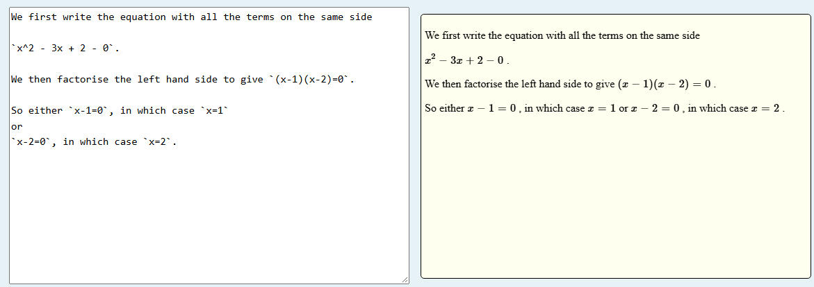
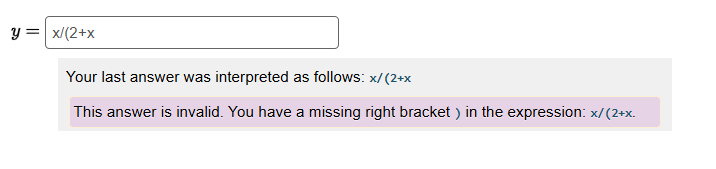

# Answering online quiz questions

Some of the online questions you will be asked to answer use the world-leading [STACK](https://stack-assessment.org/) system, which enables you to enter mathematical answers and then assesses your answers based on their mathematical properties. Many of the questions are randomised, so that if you attempt the question again, you may get a different version, and different students may see different versions of the same question.

This provides some advice on how to enter your answers to such questions. Note that individual questions may be configured in different ways, so there may be exceptions to the general advice given here. In general, there are three stages to entering your answer to these questions:

1. Typing your answer
2. Checking you entered the answer you intended
3. Submitting your answer for marking.

There is a page of [Frequently asked questions](FAQ.md) online.

## Typing your answer

There are two main styles of question you may be asked to answer: short answer questions and extended free-form text questions. These are outlined in the following sections.

### Short answer questions

Short answer questions will provide one or more boxes in which you should enter your answer(s). A typical box is shown below.

Some questions may require you to enter a number as an answer, such as \(7\), \(1.4\), \(3/4\), \(\sqrt{3}\) or \(2\pi\).

Note that square roots are entered by typing `sqrt`, so to enter 
\(\sqrt{3}\)  you should type `sqrt(3)`. 
Similarly, \(\pi\) is entered by typing `pi`, and since multiplication is represented by `*`, then \(2\pi\) can be entered by typing `2*pi`. (Often the question will be configured such that typing `2pi` will also work.)

Other questions may require you to enter algebraic answers, such as 

\[ \frac{x^2}{2+x} + 3\sin(4x) + e^{5x}. \] 

This can be entered into the system by typing

`x^2/(2+x) + 3*sin(4*x) + exp(5*x)`

Notice that powers are given using `^` and the syntax for exponentiation is `exp`. The denominator of the fraction in the first term has been enclosed within brackets, to ensure the whole of \(2+x\) is within the denominator.

In this example, the multiplication signs (`*`) have been included. Although many questions will accept answers without them, it is always best to enter them.

This syntax for answering short-answer questions is the syntax of the Maxima computer algebra system. The are more details on this syntax in the [Answer input (short-answer questions)](Answer_input.md) section. 

### Free-text input

Some questions may allow you to enter multiple lines of text and mathematics containing an extended solution to some problem. These questions display two panels, as shown below, one (on the left) for entering your solution and one (on the right) where your answer is displayed properly formatted. Usually, only certain lines of your solution will be marked automatically, the individual question will state what is required. Your teacher may, however, review the complete answer.

In these questions, text can be formatted using *Markdown* syntax. There are more details on this in the [Free-text: text formatting](Free_text_markdown.md) section. 

Mathematics is entered between *backticks*, for example `` ` x^2 + 2x ` `` .  If there is text on the same line as the mathematics, or on the lines immediately above or below it, then the mathematics will be displayed inline, otherwise it will be shown as displayed mathematics. The syntax used within the backticks is called AsciiMath, which is an easy-to-write syntax for mathematics. There are more details on this syntax in the [Free-text: mathematical input (introduction)](Free_text_AsciiMath_intro.md) section. 

If you know LaTeX, you can also enter LaTeX syntax, for example ` \( x^2 + 2 x \) ` for inline mathematics or ` \[ sin(x)/{x+2} \]`for displayed mathematics .

Finally, some (but not all!) questions of this type will permit you to use an internal calculator. This allows you to calculate the value of expressions, to save you having to use a separate physical device. For example, entering `{@ cos(pi) @}` will display the result, which is \(-1\). (Note that angles are assumed to be in radians.) Decimal answers may be displayed to a large number of decimal places. To round an answer, for example to 3 decimal places, use `{@ round(cos(2), 3) @}`.

## Checking your answer

Once you have entered your answer, most questions will display the parts of your answer that will be automatically marked in the correct mathematical format. An example is shown below.

**It is important that you check this to make sure you have entered what you intended.** 
For example, it is easily to accidentally enter

`x^2/2+x` which gives \(\displaystyle \frac{x^2}{2} + x\)

when you meant to enter

`x^2/(2+x)` which gives \(\displaystyle \frac{x^2}{2 + x}\).

If you have accidentally not entered the answer you intended, you can change it by updating what you have typed within the answer box.

Some questions will restrict the type of answer you can enter, to help you answer the question in the way that is intended. For example, questions that require an exact answer may prevent you from entering a decimal number (sometimes known as a floating-point number.) If you attempt to enter a decimal number, a warning is shown, as illustrated below.

Similar warnings are also shown if your answer does not contain matching brackets.

If you do see such a warning, you can again update your answer in the answer box to correct it.

**Make sure that you check for any warnings and correct your answer before continuing.**

## Submitting your answer for marking

Once you are happy that you have entered the answer you intended 
and have checked there are no warnings or error messages shown,
you should submit your answer for automatic marking by pressing the `Check` button below the answer box.

You will then be given feedback on your answer, and if it is not correct many questions will let you have another attempt.
