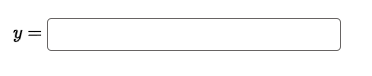
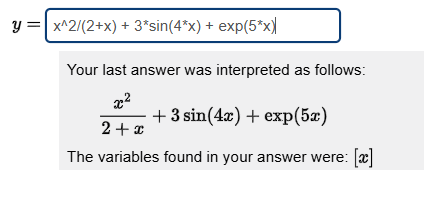
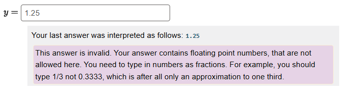

<!-- Drafting a new Student Guide for STACK 
     Tim Lowe
     September 2026 
 -->

<!-- YAML specification of document header for pandoc PDF -->
<!-- (could attempt via -M title=".." pandoc option, but ignores the formatting) -->

--- 
title: "\\textbf{STACK Student Guide} 
\\vspace*{-2\\baselineskip}"

include-before: |
  \begin{center}
    \includegraphics[width=4cm]{logo_large.png}
  \end{center}
  
---

<!--
Note:
. Below we temporarily define  *... ** aka HTML <em>
  to give coloured text to indicate drafting notes
. Stop h1 giving capital text (ghostwriter quirk)
-->

(*This style of text is drafting notes*)

# Answering online quiz questions

*This text should replace that at
(https://docs.stack-assessment.org/en/Students/index.md)*

*I was not sure the best title. I want to avoid using the term STACK as most students will not know the name of the system, nor need to know it! I wanted to ensure this works for questions in both quizzes and embedded in other materials, for example text books*

Some of the online questions you will be asked to answer use the world-leading [STACK](https://stack-assessment.org/) system, which enables you to enter mathematical answers and then assesses your answers based on their mathematical properties. Many of the questions are randomised, so that if you attempt the question again, you may get a different version, and different students may see different versions of the same question.

This document provides some advice on how to enter your answers to such questions. Note that individual questions may be configured in different ways, so there may be exceptions to the general advice given here. In general, there are three stages to entering your answer to these questions:

1. Typing your answer
2. Checking you entered your intended answer
3. Submitting your answer for marking.

There is a page of [Frequently asked questions](FAQ.md) online.

## Typing your answer

Most questions will provide one or more boxes in which you should enter your answer(s). A typical box is shown below.

Some questions may require you to enter a number as an answer, such as $7$, $1.4$, $3/4$, $\sqrt{3}$ or $2\pi$.

Note that square roots are entered by typing `sqrt`, so to enter 
$\sqrt{3}$ you should type `sqrt(3)`. 
Similarly, $\pi$ is entered by typing `pi`, and since multiplication is represented by `*`, then $2\pi$ can be entered by typing `2*pi`. (Often the question will be configured such that typing `2pi` will also work.)

Other questions may require you to enter algebraic answers, such as $$\displaystyle \frac{x^2}{2+x} + 3\sin(4x) + e^{5x}.$$
This can be entered into the system by typing

`x^2/(2+x) + 3*sin(4*x) + exp(5*x)`

Notice that powers are given using `^` and the syntax for exponentiation is `exp`. The denominator of the fraction in the first term has been enclosed within brackets, to ensure the whole of $1+x$ is within the denominator.

In this example, the multiplication signs (`*`) have been included. Although many questions will accept answers without then, it is always best to enter them.

There are more details on the syntax needed to enter your answer in the [Answer input](Answer_input.md) section. There are some forms of question that require a slightly different form of input. These are described in the [Free-text input](https://docs.stack-assessment.org/en/Students/Free_text/) section of the online documentation.

## Checking your answer

Once you have entered your answer, most questions will display what you have entered in the correct mathematical format. An example is shown below.

**It is important that you check this to make sure you have entered what you intended.** 
For example, it is easily to accidentally enter

`x^2/2+x` which gives $\displaystyle \frac{x^2}{2} + x$

when you meant to enter

`x^2/(2+x)` which gives $\displaystyle \frac{x^2}{2 + x}$.

If you have accidentally not entered the answer you intended, you can change it by updating what you have typed within the answer box.

Some questions will restrict the type of answer you can enter, to help you answer the question in the way that is intended. For example, questions that require an exact answer may prevent you from entering a decimal number (sometimes known as a floating-point number.) If you attempt to enter a decimal number, a warning is shown, as illustrated below.

Similar warnings are also shown if your answer does not contain matching brackets.

If you do see such a warning, you can again update your answer in the answer box to correct it.

**Make sure that you check for any warnings and correct your answer before continuing.**

## Submitting your answer for marking

Once you are happy that you have entered the answer you intended 
and have checked there are no warnings or error messages shown,
you should submit your answer for automatic marking by pressing the `Check` button below the answer box.

You will then be given feedback on your answer, and if it is not correct many questions will let you have another attempt.
